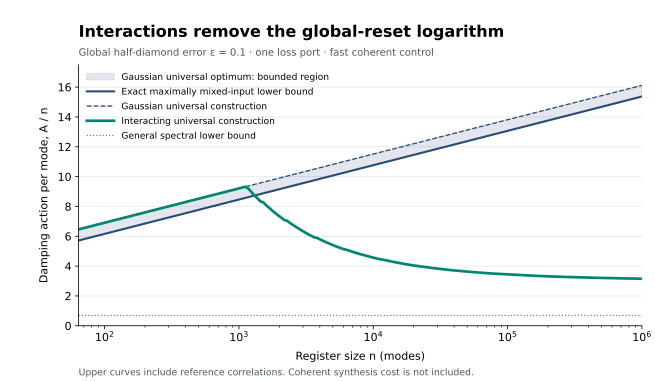

# Fermionic Reset Complexity

**Interactions can remove a logarithmic dissipation cost from whole-register reset.** For $`n`$ fermionic modes coupled to one Markovian vacuum-loss port, arbitrary fast Gaussian control requires damping action $`\Theta_\epsilon(n\ln n)`$ to reset the complete register at fixed global error. Parity-preserving interacting control achieves $`\Theta_\epsilon(n)`$ under the same loss resource and without supplied pure ancillary modes.

The action is the integrated total damping rate. The reset error is half the diamond distance to vacuum replacement, so the guarantee includes an unknown input entangled with a reference. Coherent synthesis, locality and gate duration are unpriced. Both classes may use input-independent classical randomization over Gaussian unitaries, with the action cap enforced in every branch.

## Principal results

| Result | Statement | Authoritative account |
|---|---|---|
| Exact Gaussian state frontier | From the maximally mixed input, equal loss exposure maximizes vacuum probability at every action. | [Gaussian bound](science/gaussian_bound.md) |
| Universal Gaussian reset | Fixed global error requires order $`n\ln n`$ action, including arbitrary time-dependent quadratic controls and pairing. | [Model and hierarchy](science/model.md), [universal upper bound](science/interacting_reset.md) |
| Universal interacting reset | Parity-preserving entropy compression reaches order $`n`$ action; a spectral inflow bound proves the matching order. | [Interacting reset](science/interacting_reset.md) |
| Explicit finite-register advantage | A deterministic threshold schedule gives concrete action bounds and a smaller asymptotic achievable coefficient. | [Finite-size protocol](science/finite_size.md) |

For action $`A`$, the exact maximum vacuum probability from $`I/2^n`$ is

```math
F_{\mathrm G}(n,A)=\left(1-\frac12 e^{-A/n}\right)^n.
```

The proof covers arbitrary linear Lindblad operators in addition to the single-port model. Equal exposure through the single port attains the bound. This exact selected-input formula supplies a lower bound for universal reset; the finite-action universal Gaussian optimum is not asserted to equal it.



At global error $`\epsilon=0.1`$ and $`n=4096`$, the explicit interacting protocol has action at most $`23526.321`$, while every allowed Gaussian protocol requires at least $`40447.996`$. These are certified construction-versus-converse bounds under the stated action model. The plotted values are generated from [the protocol implementation](verification/finite_protocol.py), including integer rounding and final cleanup.

## Read the science

Begin with the [scientific overview](science/README.md) for the connected argument. The [model](science/model.md) fixes the operation classes, reference system, rate convention and error criterion. The [Gaussian proof](science/gaussian_bound.md) derives the exact spectral-defect constraint. The [interacting construction](science/interacting_reset.md) proves parity-safe compression and reference-stable reset. The [interpretation](science/interpretation.md) explains what the separation establishes about initialization resources.

The [related-work account](references/RELATED_WORK.md) compares the closest primary results and attributes the inherited Gaussian formalism, single-port cooling and algorithmic compression. A [structured bibliography](references/references.bib) accompanies it.

## Learn the argument

The educational anchor is John Watrous's *The Theory of Quantum Information* (2018). The [Watrous bridge](learning/WATROUS_BRIDGE.md) identifies the useful sections, translates notation and explains the additional fermionic and control arguments supplied here. The [30-milestone map](learning/MILESTONES.md) connects the background to the complete scientific contribution, with dependencies and source pointers for each understanding target. It is a common reading route for any reader; no whole-book prerequisite is assumed.

## Reproduce the finite checks

Use Python 3.12 with the pinned dependencies:

```bash
python -m pip install -r verification/requirements.txt
python verification/check_gaussian_action.py
python verification/gaussian_hilbert_conventions.py
python verification/check_reference_twirl.py
python verification/finite_protocol.py
python verification/plot_action_scaling.py
```

The [verification guide](verification/README.md) explains the tested cases, output files and limits of the numerical evidence. The analytical proofs establish the arbitrary-control and arbitrary-reference statements; finite checks validate rate conventions, identities, saturation and explicit examples.

## Scope

The logarithm concerns **global** reset accuracy. Constant local mean occupation is a different criterion. Pure ancillary modes, measurements, postselection and feedback from bath records are outside the operation classes. The interacting upper bound uses arbitrary parity-preserving permutations and does not provide an efficient local circuit for them. At a fixed total damping-rate cap, action controls dissipative exposure; complete hardware time also depends on implementing the coherent controls.

## Purpose and contact

This repository serves as a record of the work and a guide for the author’s self-directed learning. For discussion or potential collaboration, please contact Ruge Lin at [gogoko699@gmail.com](mailto:gogoko699@gmail.com).
