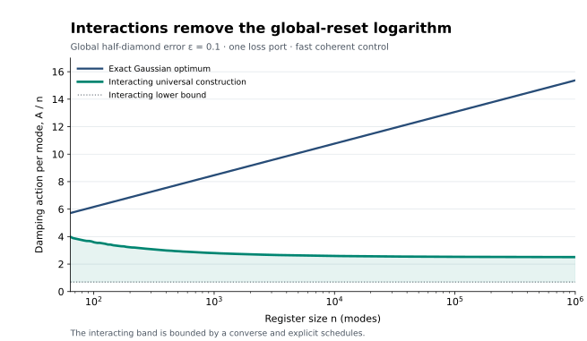

# Fermionic Reset Complexity

**How much loss is needed to reset an unknown fermionic register?** For a register of n modes and a single Markovian vacuum-loss port, the optimal Gaussian reset error is known exactly. Parity-preserving interactions can reset the same register using less loss, including at high precision.

Loss action is the time integral of the port's damping rate. The error is half the diamond distance to vacuum replacement. It tests the entire output and its correlations with any reference. Both control classes allow fast global coherent control and input-independent classical randomization, and every branch obeys the action budget.

## Principal results

At action cap $`A`$, the optimal Gaussian reset error is

```math
r_{\rm G}(n,A)=1-\left(1-\tfrac12 e^{-A/n}\right)^n+2^{-n}e^{-A}.
```

The last term accounts for the worst input, the maximally mixed odd-parity state. An even Gaussian twirl followed by equal loss exposure of every mode attains the formula. The [proof](science/universal-frontier.md) also reduces optimal interacting reset to vacuum preparation from the maximally mixed register.

| Loss-action result | Gaussian control | Parity-preserving interacting control |
| --- | --- | --- |
| Joint dependence on size and target error $`0<\epsilon\le1/2`$ | $`\Theta(n\ln(n/\epsilon))`$ | $`\Theta(n+\ln(1/\epsilon))`$ |
| Error exponent as action grows at fixed $`n\ge2`$ | $`1/n`$ | $`1/2`$ |

The [interacting construction](science/interacting-frontier.md) uses repeated contacts with the same loss port. The controls arrange occupation strings in balanced opposite-parity matchings. A tree schedule gives the joint action bound, and a cycle schedule attains the fixed-size exponent. At three modes and action $`32\ln 2`$, 32 contacts achieve half-diamond error $`39/65536`$, strictly below the Gaussian optimum at that action.



## Read the science

- [Model](science/model.md) for the action, control and error conventions.
- [Gaussian cooling bound](science/gaussian_bound.md) for the exact maximally mixed-input result.
- [Universal frontier](science/universal-frontier.md) for the parity reduction and exact Gaussian channel optimum.
- [Interacting frontier](science/interacting-frontier.md) for the matching schedules, lower bounds and finite example.
- [Entropy compression](science/interacting_reset.md) and [finite-size schedules](science/finite_size.md) for the alternative interacting protocol.
- [Scientific overview](science/README.md), [interpretation](science/interpretation.md) and [primary references](references/RELATED_WORK.md).

## Learn the argument

The educational anchor is John Watrous's *The Theory of Quantum Information* (2018). The [Watrous bridge](learning/WATROUS_BRIDGE.md) identifies the useful sections, translates notation and explains the additional fermionic and control arguments supplied here. The [30-milestone map](learning/MILESTONES.md) connects the background to the complete scientific contribution, with dependencies and source pointers for each understanding target. It is a common reading route for any reader; no whole-book prerequisite is assumed.

## Reproduce the finite checks

Use Python 3.12 with the pinned dependencies:

```bash
python -m pip install -r verification/requirements.txt
python verification/check_gaussian_action.py
python verification/gaussian_hilbert_conventions.py
python verification/check_reference_twirl.py
python verification/check_reset_frontier.py
python verification/finite_protocol.py
python verification/plot_action_scaling.py
```

The [verification guide](verification/README.md) explains the tested cases, output files and limits of the numerical evidence. The analytical proofs establish the arbitrary-control and arbitrary-reference statements; finite checks validate rate conventions, identities, saturation and explicit examples.

## Scope

All system modes are retained. The protocols use no supplied pure quantum workspace, measurements, postselection or bath-record feedback. The action counts dissipative exposure. Hardware time also depends on the rate cap, coherent synthesis, locality and switching. The leading interacting action coefficient at fixed target error and the exact interacting frontier for three or more modes remain open.

## Purpose and contact

This repository serves as a record of the work and a guide for the author’s self-directed learning. For discussion or potential collaboration, please contact Ruge Lin at [gogoko699@gmail.com](mailto:gogoko699@gmail.com).
